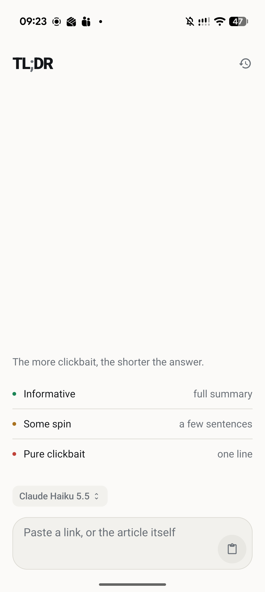
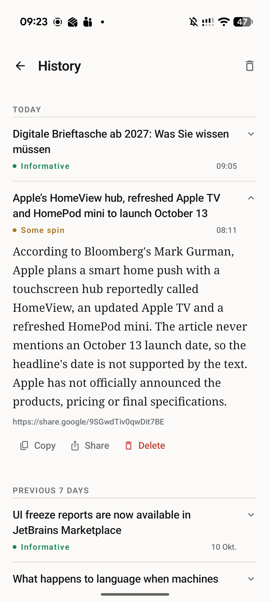
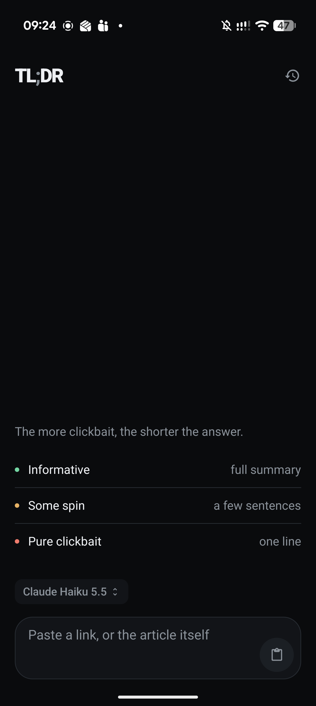
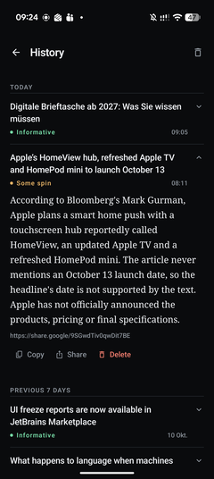

# TL;DR

An Android app that summarizes articles with AI. The more clickbait, the shorter the answer.

<p>
  
  
</p>
<p>
  
  
</p>

## How it works

Paste a URL or some text and the app scores how clickbaity it is, then sizes the summary to match.

| Article | Response |
|---|---|
| Informative | Short paragraph or bullet points |
| Moderately clickbaity | 2–3 sentences |
| Highly clickbaity | One sentence |

The score is shown as a verdict (Informative / Some spin / Pure clickbait) with a 12-segment meter instead of a percentage.

## Features

- **Single input.** URLs and pasted text are detected automatically.
- **Share-sheet integration.** Share a link from any app and a floating card summarizes it in place, without opening the app.
- **Model picker.** Choose between Claude and GPT models, loaded live from the gateway catalog.
- **Streaming.** Responses stream over SSE, with live reasoning shown for OpenAI models.
- **History.** The last 50 summaries, expandable in place and individually deletable.
- **Light and dark themes.** A monochrome ink-and-paper palette where the only color is the verdict.

## Tech stack

Kotlin · Jetpack Compose (Material 3) · OkHttp (SSE) · Gson · SharedPreferences

Min SDK 30 (Android 11), target SDK 36. All AI requests go through [Eden AI](https://www.edenai.co/).

## Getting started

1. Add your Eden AI key to `local.properties` (gitignored):

   ```properties
   EDENAI_API_KEY=your_key_here
   ```

2. Build and install:

   ```bash
   ./gradlew assembleDebug
   ./gradlew installDebug
   ```

3. For the floating card, grant **Display over other apps** to the app on the device.

### Tests

```bash
./gradlew testDebugUnitTest
```

Enable the pre-commit hook, which runs the unit tests before each commit:

```bash
git config core.hooksPath .githooks
```

## Switching AI providers

The provider is isolated to a handful of files, so it can be swapped without touching the UI. The repo ships an agent skill, [`switch-providers`](.agents/skills/switch-providers/SKILL.md), that encodes the full procedure: which files to edit and in what order, how to inspect a provider's real model catalog before writing the filter, and common pitfalls such as a stale API key name or a saved model id from the old provider.

It was used for the moves Azure gateway → Nexos → Eden AI. Ask your coding agent to "switch the provider to X" and the skill takes over.

Skills follow the open `SKILL.md` format and live in [`.agents/skills/`](.agents/skills), which most agents read. Claude Code reads `.claude/skills`, which is a symlink to the same folder.

## Project structure

```
app/src/main/java/com/example/tldr_ai/
├── MainActivity.kt            # Home / History routes
├── ShareReceiverActivity.kt   # Share-sheet entry point
├── floatingcard/              # Overlay service for shared links
├── data/
│   ├── api/                   # Gateway client, model catalog
│   ├── model/                 # Domain and UI state types
│   └── repository/            # Summary, history, catalog, settings
└── ui/                        # Components, screens, ViewModel, theme
```

See [CLAUDE.md](CLAUDE.md) for design notes and project conventions.
